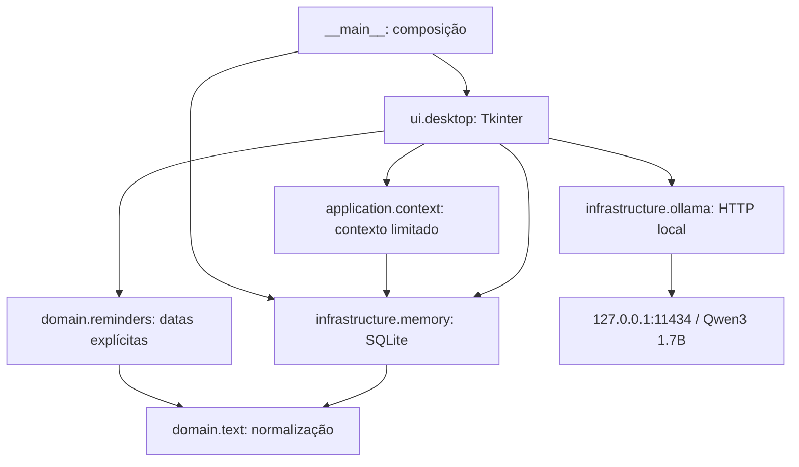
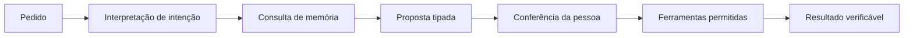

# Arquitetura da KiKi

## Escopo

Aplicativo desktop de um usuário no Windows. Texto primeiro, execução local e recursos limitados. Não há servidor web, conta online, serviço de sincronização ou execução de comandos pelo modelo. Uma instância por vez é a orientação operacional desta versão.

## Componentes existentes

| Camada | Responsabilidade | Limite |
| --- | --- | --- |
| domain | Normalização e datas | Sem banco, interface ou rede |
| application | Preparar contexto de consulta | Ainda não contém coordenador de agente |
| infrastructure | Persistência e comunicação com Ollama | Não interpreta comandos livres como ações |
| ui | Coleta, validação visual, eventos e apresentação | Parte da coordenação ainda reside aqui; migração será incremental |
| composição | Criar banco e janela | Define armazenamento local |

## Fluxos atuais

1. Registro: texto → botão Guardar → INSERT parametrizado → atualização da listagem.
2. Consulta: pergunta → busca textual → até 8 registros, 500 caracteres cada → Ollama → resposta. Não existe histórico persistente de conversa.
3. Lembrete: frase opcional → parser determinístico → campos preenchidos → conferência → botão Criar → persistência.
4. Aviso: ciclo de 15 segundos consulta vencidos não avisados → janela com som → reconhecimento → pendência continua até conclusão.
5. Backup: seletor de destino → API SQLite backup → arquivo fechado após cópia.

SQLite permanece na thread principal. A chamada HTTP roda em thread de trabalho e devolve resultados por fila, evitando travar a janela. Não mover conexões SQLite entre threads. O fechamento durante uma consulta encerra a interface; a resposta não será persistida.

## Persistência atual

Esquema 2 (`PRAGMA user_version`): `notes(id, text, created, updated, revision)` e `tasks(id, text, due, done, alerted)`. Datas são locais, sem fuso embutido. Não há suporte a viagem entre fusos nem recorrência. IDs e datas dos registros antigos e todos os campos dos lembretes são preservados na migração.

`infrastructure/migrations.py` reconhece o banco original sem versão e a base na versão 1. Antes de atualizar um arquivo existente, cria uma cópia consistente na mesma pasta. A migração ocorre em uma transação; falha reverte esquema e versão. Bancos de versões futuras ou estrutura não reconhecida são recusados. A conexão é fechada se a inicialização falhar, com mensagem visível na abertura da KiKi.

A migração 2 reconstrói a tabela de registros dentro da transação, preservando IDs/textos/datas e usando AUTOINCREMENT para impedir reutilização de IDs excluídos. Acrescenta data de alteração e revisão. Editar e excluir exigem a revisão lida anteriormente; linha ausente ou revisão divergente produz erro, sem anunciar sucesso. As operações não alteram cópias antigas de segurança. A interface usa uma lista selecionável, prévia completa, editor separado e confirmação explícita antes da exclusão.

## Arquitetura alvo do agente — planejada

O coordenador ficará em `application/agent.py` quando implementado. Contratos de propostas e resultados ficarão em `domain/`; ferramentas específicas em `application/tools/`. Não criar diretórios vazios como se essas funções já existissem.

Contrato proposto: `ActionProposal(id, kind, payload, state)` com tipos permitidos `save_note`, `create_reminder`, `update_note`, `complete_reminder`. Estados: proposta, confirmada, executada, cancelada ou falhou. A execução exige confirmação vinculada ao ID e proteção contra repetição. Nenhum texto do modelo vira SQL, shell ou Python executável. Uma falha não pode produzir mensagem de sucesso.

Pedidos com várias alterações, como registro mais lembrete, precisarão de transação ou apresentação explícita de resultados parciais. Campos ausentes geram pergunta; não se inventam nomes, datas ou horários.

## Evolução e limites

- Primeiro testar busca textual; embeddings só serão considerados se as perguntas de aceitação demonstrarem necessidade.
- Primeiro testar o modelo pequeno; não aumentar o consumo sem medir com programas de trabalho abertos.
- Configuração persistente fica em `infrastructure/settings.py`; diagnóstico local em `application/diagnostics.py`. A seção Configuração no menu lateral permite escolher o modelo e verificar `/api/tags` sem enviar registros. O endpoint permanece fixo em loopback.
- `ui/workspace.py` organiza quatro páginas persistentes e a navegação lateral. Trocar de página não recria os campos nem acessa o banco. Conversa é a página inicial; a seção Configuração ainda usa a área central, até M09.3.
- `ui/appearance.py` centraliza as paletas violeta dos temas Claro/Escuro e reaplica cores sem reconstruir as páginas. `ui/rounded.py` fornece superfícies, botões, campos e seletores arredondados. Inter acompanha o aplicativo com licença e é registrada privadamente no Windows por `infrastructure/fonts.py`; nenhuma fonte do sistema é substituída.
- Coordenador, ferramentas por conversa e lembretes em segundo plano ainda não existem.
- Não há isolamento entre usuários, criptografia própria nem proteção contra malware na conta Windows.
