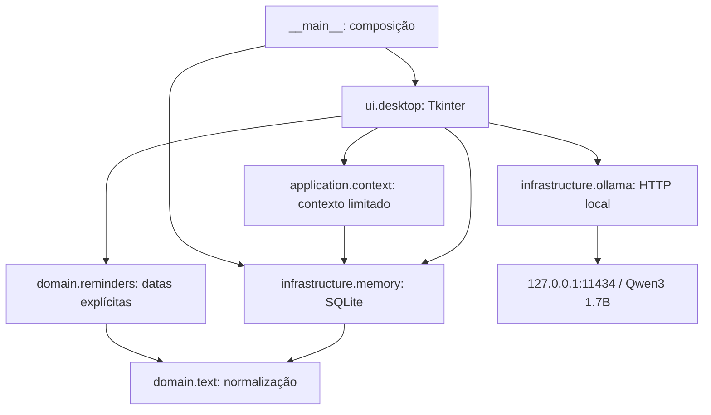
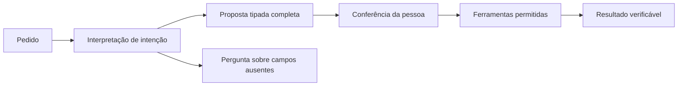

# Arquitetura da KiKi

## Escopo

Aplicativo desktop de um usuário no Windows. Texto primeiro, execução local e recursos limitados. Não há servidor web, conta online, serviço de sincronização ou execução de comandos pelo modelo. Uma instância por vez é a orientação operacional desta versão.

## Componentes existentes

| Camada | Responsabilidade | Limite |
| --- | --- | --- |
| domain | Normalização e datas | Sem banco, interface ou rede |
| application | Preparar contexto e coordenar propostas confirmadas | Só duas ferramentas tipadas: guardar registro e criar lembrete |
| infrastructure | Persistência e comunicação com Ollama | Não interpreta comandos livres como ações |
| ui | Coleta, validação visual, eventos e apresentação | Parte da coordenação ainda reside aqui; migração será incremental |
| composição | Criar banco e janela | Define armazenamento local |

## Fluxos atuais

1. Registro: texto → botão Guardar → INSERT parametrizado → atualização da listagem.
2. Consulta: pergunta → busca textual por palavras inteiras → até 8 registros, 500 caracteres cada → Ollama → resposta. A fila preserva o contexto enviado para inspeção posterior; IDs citados que não estavam nele geram aviso. Não existe histórico persistente de conversa.
3. Lembrete: frase opcional → parser determinístico → campos preenchidos → conferência → botão Criar → persistência.
4. Aviso: ciclo de 15 segundos consulta vencidos não avisados → janela com som → reconhecimento → pendência continua até conclusão.
5. Backup: seletor de destino → API SQLite backup → arquivo fechado após cópia.
6. Recuperação: abrir origem somente para leitura → conferir integridade e esquema → criar destino exclusivamente novo → backup SQLite → conferir integridade do resultado. O banco em uso não é trocado.
7. Pedido explícito: gramática determinística → pergunta sobre campos ausentes ou proposta imutável → conferência por ID → confirmação → gravação transacional das ações e do comprovante → resultado com IDs. O Ollama não participa desse fluxo.

SQLite permanece na thread principal. A chamada HTTP roda em thread de trabalho e devolve resultados por fila, evitando travar a janela. Não mover conexões SQLite entre threads. O fechamento durante uma consulta encerra a interface; a resposta não será persistida.

## Persistência atual

Esquema 3 (`PRAGMA user_version`): `notes(id, text, created, updated, revision)`, `tasks(id, text, due, done, alerted)` e `action_receipts(proposal_id, signature, note_id, task_id, executed)`. Datas são locais, sem fuso embutido. Não há suporte a viagem entre fusos nem recorrência. IDs e datas dos registros antigos e todos os campos dos lembretes são preservados na migração.

`infrastructure/migrations.py` reconhece os bancos anteriores sem versão, v1 e v2. Antes de atualizar um arquivo existente, cria uma cópia consistente na mesma pasta. A migração ocorre em uma transação; falha reverte esquema e versão. Bancos de versões futuras ou estrutura não reconhecida são recusados. A conexão é fechada se a inicialização falhar, com mensagem visível na abertura da KiKi.

A migração 2 reconstrói a tabela de registros dentro da transação, preservando IDs/textos/datas e usando AUTOINCREMENT para impedir reutilização de IDs excluídos. Acrescenta data de alteração e revisão. Editar e excluir exigem a revisão lida anteriormente; linha ausente ou revisão divergente produz erro, sem anunciar sucesso. As operações não alteram cópias antigas de segurança. A interface usa uma lista selecionável, prévia completa, editor separado e confirmação explícita antes da exclusão.

## Agente com ações confirmadas — primeira implementação

O coordenador está em `application/agent.py`. Contratos imutáveis em `domain/actions.py`, interpretação limitada em `domain/requests.py` e entrada de ferramentas em `application/tools/__init__.py`. A interface nunca interpreta respostas do modelo como propostas.

Contrato atual: `ActionProposal(id, request, actions, state, result, error)`, com uma ou duas ações `SaveNote` e `CreateReminder`, no máximo uma de cada. Estados: proposta, confirmada, executada, cancelada ou falhou. A confirmação é vinculada ao ID da sessão e ao conteúdo imutável mostrado em `ui/proposal.py`. Edição de registros e conclusão de lembretes por ferramentas continuam futuras; hoje usam os botões existentes.

`Memory.apply_actions` adquire bloqueio de escrita, confere o comprovante do ID, valida o horário e grava registro, lembrete e comprovante em uma transação. Falha reverte tudo. O comprovante guarda hash do conteúdo tipado e IDs resultantes; o mesmo ID/conteúdo retorna o resultado anterior, inclusive após reabrir o banco. ID com conteúdo diferente é recusado. Reenviar o texto é um novo pedido e não é deduplicado semanticamente.

Campos ausentes geram pergunta e exigem reenvio do pedido completo; não há coleta livre de campos em vários turnos. Propostas pendentes/canceladas permanecem só na sessão. Confirmação textual como “sim” não executa. O executor não recebe shell, SQL ou código do modelo. Nem uma falha nem uma proposta não confirmada anunciam gravação concluída.

## Evolução e limites

- Primeiro testar busca textual; embeddings só serão considerados se as perguntas de aceitação demonstrarem necessidade.
- Busca compara tokens inteiros normalizados, sem acentos e palavras funcionais. Empates mantêm registros mais recentes primeiro. Não oferece sinônimos, flexões ou busca semântica. Os testes de aceitação usam IDs esperados e não dependem de resposta do modelo.
- `ui/sources.py` mostra os trechos exatos enviados na consulta, mesmo que o registro seja editado depois. A checagem de citações em `application/context.py` reconhece [ID] e #ID; presença do ID não comprova que o registro sustenta a afirmação, e outros formatos de citação não são interpretados.
- Primeiro testar o modelo pequeno; não aumentar o consumo sem medir com programas de trabalho abertos.
- Configuração persistente fica em `infrastructure/settings.py`; diagnóstico local em `application/diagnostics.py`. A seção Configuração no menu lateral permite escolher o modelo e verificar `/api/tags` sem enviar registros. O endpoint permanece fixo em loopback.
- `ui/workspace.py` organiza quatro páginas persistentes e a navegação lateral. Trocar de página não recria os campos nem acessa o banco. Conversa é a página inicial; a seção Configuração ainda usa a área central, até M09.3.
- `ui/appearance.py` centraliza as paletas violeta dos temas Claro/Escuro e reaplica cores sem reconstruir as páginas. `ui/rounded.py` fornece superfícies, botões, campos e seletores arredondados. Inter acompanha o aplicativo com licença e é registrada privadamente no Windows por `infrastructure/fonts.py`; nenhuma fonte do sistema é substituída.
- A gramática cobre pedidos explícitos e o cenário combinado do roadmap; não é um interpretador geral. Avisos ainda exigem aplicativo aberto, sem serviço de lembretes em segundo plano.
- Não há isolamento entre usuários, criptografia própria nem proteção contra malware na conta Windows.
